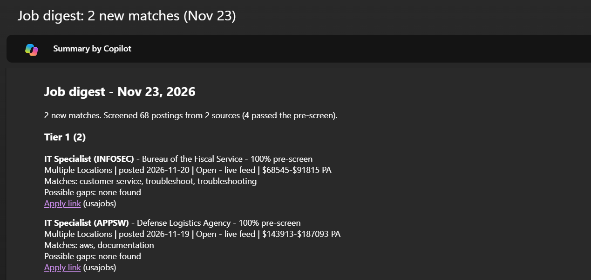

# Daily Job Digest

> **Status: built, deployed, and working, but not as useful as I hoped yet. Still fine-tuning.**
> The pipeline is proven: it has run on its own on AWS and delivered real postings, with pay and apply links, to my inbox. My first live run saw 62 postings, 3 passed my filters, and all 3 landed in the digest. What still needs work is the quality and size of the results, and I explain why below.

## Overview

**What it does:** Every morning it checks USAJobs and Remotive for new IT support jobs, filters out the ones that are too old, too senior, or too far away, scores the rest against my resume, and emails me a short list with apply links.

**Who it's for:** I built it for myself as an IT job seeker in New Jersey, but it works for anyone who wants less time scrolling job boards and more time reading the postings worth applying to.

**What I built:** The whole thing runs on AWS using EventBridge, Lambda, DynamoDB, and SES, deployed with SAM, and I tested and troubleshot it myself until the first live digest landed in my inbox.

## Why I built it

Job hunting was eating a lot of time, and I kept seeing the same postings over and over. I wanted the searching and sorting handled automatically so I could spend my time on the part that matters: reading the good ones and applying. It also gave me a real project to build end to end on AWS, from the daily trigger to the email in my inbox, instead of only following a tutorial.

## How it works

Once a day it:

1. Pulls recent postings from two places: federal jobs from the USAJobs API and remote IT and customer service jobs from Remotive
2. Throws out anything older than 14 days
3. Keeps roles near me (a commutable area in NJ) or remote jobs open to US applicants
4. Keeps only jobs open to the public, and only IT support type titles, dropping senior, lead, and supervisory ones
5. Scores each job against the skills on my resume and keeps the strong matches
6. Remembers what it has already sent, so I never get the same job twice
7. Checks whether the posting still looks open
8. Emails me the shortlist with apply links

If a source fails, the email says so in a "Source issues" section at the bottom, so a quiet day never gets confused with a broken run.

## How to use it

**Day to day, there's nothing to run.** It checks for jobs by itself every morning.

1. Look for an email titled something like "Job digest: 3 new matches."
2. Read the list. Each job shows the title, employer, location, a match score, and an apply link.
3. Open the ones that look good, read the full posting, and apply.

If nothing new turned up, I get a short email saying so.

**To try it on your own computer** (no AWS needed, but you need a free USAJobs API key set in your terminal first):

```
python run_local.py usajobs
```

It prints the same kind of list right in the terminal.

**A real digest from a test run (Nov 23, 2026):**



Each entry shows the title, agency, a pre-screen score, location, posting date, whether the posting was confirmed open, the pay, the skills it matched, any gaps, and the apply link.

**The terminal output from the same run:**


The function finished with no errors or warnings. It saw 68 postings from 2 sources, 4 passed my filters, and 2 were new. The run took about 40 seconds, mostly from a deliberate pause between Remotive calls to stay under their rate limit.

## Architecture

```
EventBridge (daily timer)
   -> Lambda (Python 3.12, no third-party packages)
        -> USAJobs API + Remotive API
        -> filter + score
        -> DynamoDB (remembers what was sent)
        -> SES (sends the email)
```

- **EventBridge** runs the function on a daily schedule (12:00 UTC, which is 7 or 8 AM Eastern).
- **Lambda** runs the Python code. I kept it free of third-party packages so there's nothing to bundle.
- **DynamoDB** is the memory. A conditional write is how it tells whether a job is new, and old entries expire after 60 days on their own.
- **SES** sends the email.
- **SAM** (`template.yaml`) defines all of it. I built and tested the first version with SAM.

## Job sources

| Source | What it covers | Notes |
|---|---|---|
| USAJobs | Federal jobs near me, plus remote | Free API key, stored as an environment variable on the Lambda function. Limited to jobs open to the public. |
| Remotive | Remote jobs | No key. Searched by category (information technology, customer service), with a pause between calls to respect their rate limit. Each listing links back to Remotive and names it as the source, per their terms. |

## Design decisions

- **Free tier on purpose.** Everything is sized to stay inside the AWS free tier, so a personal project doesn't turn into a bill.
- **Settings live in a JSON file, not in the code.** Keywords, commute towns, target titles, and the weighted skill lists are all in `src/config.json`, so I can tune the search without risking a typo in the Python.
- **A human stays in the loop.** The score is a pre-screen that saves me reading hundreds of postings. I still read every full description before I apply.
- **Respecting the APIs.** I follow each source's rate limits and attribution rules instead of scraping.
- **Test before deploying.** `run_local.py` runs a source on my own computer and shows what came back and why each job was kept or filtered out. That's how I tune the filters and how I check an API key.

## Challenges and how I solved them

| What happened | What I did |
|---|---|
| The SAM CLI wasn't installed | Installed it, and checked the installer's digital signature before running it |
| AWS rejected my pasted USAJobs key ("invalid characters") | Pasted the key into a plain text editor to see the stray character, cleaned it, and cleared the bad value saved in `samconfig.toml` |
| A deploy accepted a key that was actually wrong, and the next digest showed `401 Unauthorized` | SAM only checks the characters in a value, not whether the key works. The "Source issues" section in the email caught it, and I now test a key with `run_local.py` before relying on it |
| Re-entering the USAJobs key on every `sam deploy` got tiresome | Stopped redeploying with SAM. I now update the code, settings, and key directly in the Lambda console |
| Remotive kept returning few IT jobs from keyword searches | Read their API docs and switched to searching by category, with a pause between calls to stay under their rate limit |
| A senior federal IT posting scored as a top match | The scoring only reads keywords and doesn't know the pay grade, so a GS-12 job looked like a great fit. I treat the score as a pre-screen and read every description, and the grade-level logic is something I'm still tuning |

## Where it stands

**It works.** The screenshot above is a real run. That day it pulled 68 postings from two sources, narrowed them to 4 that passed my filters, left out the ones I'd already been sent, confirmed the postings were open, and emailed me 2 new ones with pay and apply links. Nothing was run by hand.

**It isn't perfect yet.** The same email shows what I still need to fix. Both jobs scored 100%, but when I read them:

- One is an application software role (APPSW) paying $143,913-$187,093, which is well above where I'm applying. Its only matched skills were "aws" and "documentation."
- The other is a security role (INFOSEC) paying $68,545-$91,815, and its matches were "customer service" and "troubleshoot."
- Both list "Multiple Locations," so the digest can't tell me whether either is commutable.

The 100% comes from the scoring: it counts matched skills against skills I'm missing, so a posting with a couple of matches and no missing-skill words looks perfect. It also doesn't read pay or job grade. Tightening the title filters, requiring more matched skills, and adding a pay ceiling are the adjustments I'm working on.

I thought this would be a huge help, and it isn't there yet. The results are what's limited:

- **The pool of jobs is small.** The sources I can use only cover part of the market, so a lot of the roles I'd actually apply for never reach it.
- **API access has limits.** Free API keys, rate limits, and sites that don't offer a public API mean I can't pull from everywhere I'd like.
- **Matching takes tuning.** Getting the keywords, titles, and skill weights to pull the positions that line up with my background is ongoing work.

What I took from it: building the pipeline was the easier part. A tool like this is only as good as the places it pulls jobs from and the filters that decide what counts as a match, and that's where my time is going now.

## Project layout

```
template.yaml          AWS infrastructure (SAM)
docs/                  screenshots of a real digest email and run output
run_local.py           test a source on your own computer
src/
  lambda_function.py   the daily run: fetch, filter, dedupe, verify, email
  sources.py           the USAJobs and Remotive searches
  scoring.py           filtering and keyword scoring
  config.json          all settings
```

## A note on how this was made

I built this with help from an AI assistant (Claude) and tested and deployed it myself on my own AWS account. The troubleshooting above is mine, and the tuning is mine to keep working on.

*Keep API keys out of the repo. The USAJobs key lives in the Lambda's environment variables, and `samconfig.toml` stores deploy keys in plain text, so it's in `.gitignore`.*
